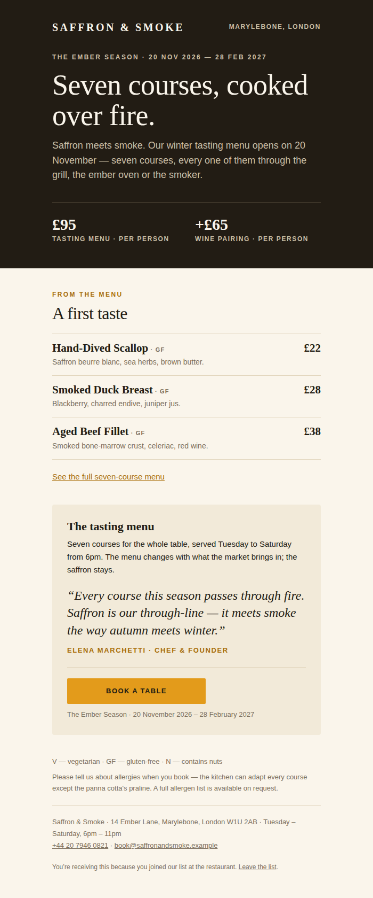
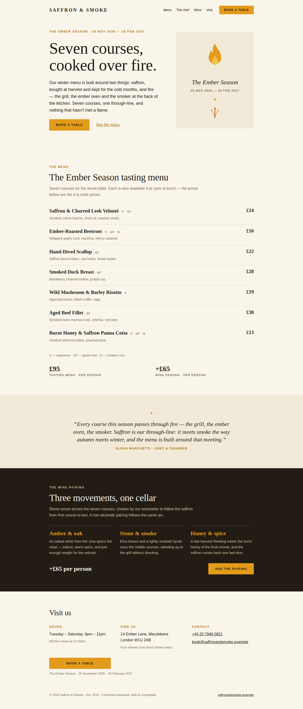
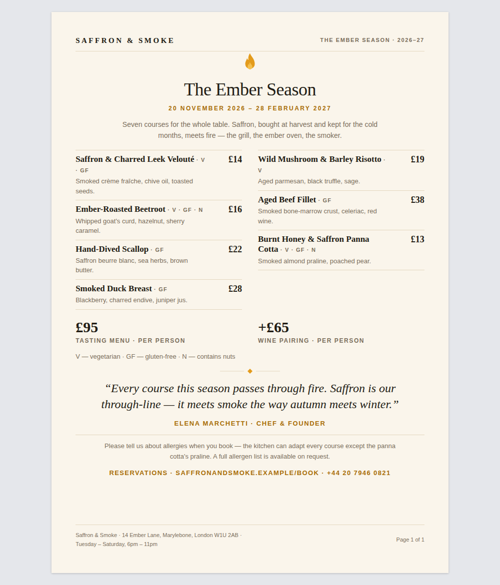
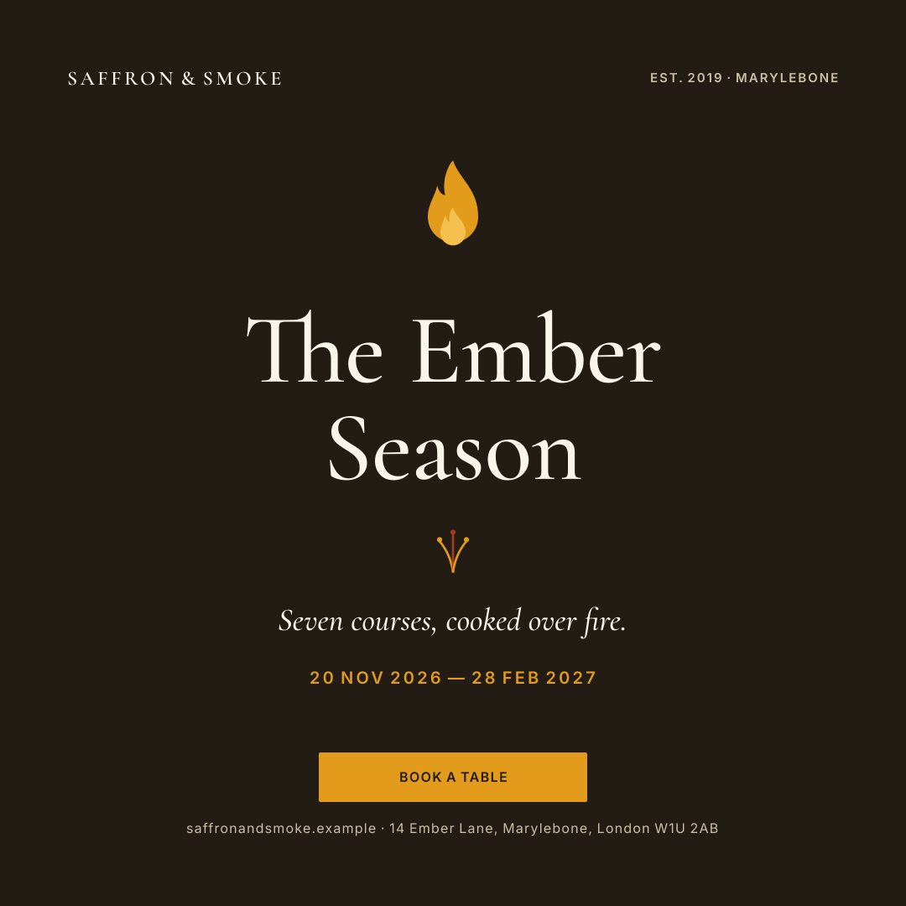

# Saffron & Smoke — a seasonal tasting-menu launch kit

A fictional restaurant launches its winter tasting menu — in four formats from
one codebase, built with [Hyper Elements](https://github.com/hyper-elements/hyper-elements)
(`@hyper-elements/react`).

**Saffron & Smoke** is a restaurant in Marylebone, London. Its winter menu,
*The Ember Season* (20 November 2026 – 28 February 2027), is seven courses
cooked over fire — the grill, the ember oven, the smoker — with saffron as the
through-line. This kit is everything the launch needs: the invitation email,
the menu page, the printable menu, and the social post that announces the
season. The restaurant, the chef, the address and the links are all invented;
the kit is a template, ready to be re-skinned with a real menu.

No external images anywhere: every visual is a Hyper Elements element or a
drawn `Svg` shape (the flame, the saffron sprig, the divider flourish).

## The four outputs

### 1. Email — the launch invitation (600px)

A charcoal poster band (wordmark, season, hero statement, tasting price),
three featured courses, a parchment tasting-menu card with the chef's note and
the reservation button, and a footer with the practical details.
`render()` also writes the plain-text twin (`out/email.txt`).



### 2. Page — the full seasonal menu (960px)

Navigation, a hero with the drawn flame and saffron motifs, all seven courses
as a table with prices and dietary marks, the chef's note, a dark wine-pairing
callout (three movements in a `Grid`), and the visit details. Rows wrap and
stack, so it holds together down to a phone
(see `docs/screenshots/page-mobile.png`).



### 3. Document — the printable A4 menu (print HTML + PDF)

One page: the flame and the season at the top, the seven courses in two ruled
columns, the tasting price, the chef's note, and the allergy note — with a
repeating header and a footer carrying page numbers. `render()` writes the
print HTML; `renderPdf()` writes the PDF from the same tree.



### 4. Canvas — the Instagram announcement (1080 × 1080)

Charcoal ground, a drawn flame, the season's name set huge in the serif, the
saffron sprig, the dates and the booking line. `renderImage()` draws it as a
PNG and as an SVG (whose text is paths, so it shows without fonts) — the SVG
below is the build's own output:



## Run it

```bash
npm install
npm run build
```

`npm run build` validates all four templates (and fails on any error), then
renders everything into `out/`:

| File | What it is |
| --- | --- |
| `out/email.html`, `out/email.txt` | The invitation, and its plain-text twin |
| `out/page.html` | The full menu page |
| `out/menu-print.html` | The printable menu (print HTML) |
| `out/menu.pdf` | The same menu as a one-page A4 PDF |
| `out/social.png`, `out/social.svg` | The 1080 × 1080 announcement |
| `out/clients/*.html` | The email as Outlook, Gmail and Apple Mail draw it |

`npm run screenshots` re-captures `docs/screenshots/` from the built HTML with
Playwright's Chromium (desktop and 390px mobile). `npm run check` typechecks.

The build needs no network and no keys: the PDF and image engines are given
their fonts as WOFF files from the `@fontsource` packages, and nothing is
fetched at render time. (The HTML outputs reference the same families as web
fonts, with Georgia / Helvetica fallbacks where a client doesn't load them.)

## How Hyper Elements was used

- **One theme, four roots.** `src/theme.ts` defines the brand once with
  `defineTheme()`: the saffron / charcoal / cream palette, Cormorant Garamond
  + Inter, a type scale per heading level, the saffron button, and named
  styles (`eyebrow`, `card`, `courseRow`, `price`) picked up with
  `style={{ apply: [...] }}`. Every root — `Email`, `Page`, `Document`,
  `Canvas` — takes the same theme, so the four outputs can't drift apart.
  Templates read tokens with `token("colors.saffron")`; the theme itself
  writes them as `"{colors.saffron}"`.
- **One data model.** `src/data.ts` is the single source of truth: the season
  and its dates, the seven courses (name, description, price, dietary marks),
  the chef and her note, the restaurant details, the reservation link. Change
  the menu there and all four outputs change.
- **Shared components.** `src/components.tsx` holds the blocks the roots
  share: `Wordmark`, `SeasonLine`, `CourseList` (ruled rows for the email and
  document, a `Table` for the page — same data, two layouts), `ChefNote`,
  `TastingLine`, `ReservationCTA`, `DietaryKey`, and the drawn motifs
  `FlameMark`, `SaffronSprig` and `Flourish` (`Svg` shapes — the email, which
  doesn't support `Svg`, gets the same rhythm from `Divider`s and colour
  bands instead).
- **All four roots, each used for what it's for.** The `Email` is 600px with
  a preview text and a plain-text twin; the `Page` is 960px with wrapping
  `Row`s and a `Grid`; the `Document` is A4 with a `PageHeader`, a
  `PageFooter` carrying `PageNumber`s, and its courses in a two-column `Grid`;
  the `Canvas` is 1080 × 1080 with `justifyContent: "space-between"`.
- **Validation as a build gate.** `scripts/build.tsx` runs `validate()` on
  every template before rendering anything, and fails the build on any error.
  The email is also checked with the `@hyper-elements/email-clients` plugin,
  which adds what classic Outlook, Gmail, Apple Mail and the rest remove or
  change — the build prints those notes (21 of them, all expected: no web
  fonts in most clients, no letter-spacing in Word's Outlook, square corners
  in classic Outlook). `renderInEmailClients()` then writes a preview per
  client to `out/clients/`, so the email can be checked as each client draws
  it. The canvas carries one expected warning: a hover can't show in an
  image.
- **PDF and image from the same trees.** `renderPdf()` (via
  `@hyper-elements/react/pdf`) draws the `Document` as a one-page A4 PDF, and
  `renderImage()` (via `@hyper-elements/react/image`) draws the `Canvas` as
  PNG and SVG — both given their fonts as files, so the outputs are
  deterministic and offline.

## Project structure

```
saffron-smoke/
├── src/
│   ├── data.ts          the menu, the season, the chef, the restaurant
│   ├── theme.ts         the brand: palette, fonts, type scale, named styles
│   ├── fonts.ts         WOFF files for the PDF and image engines
│   ├── components.tsx   shared blocks + drawn Svg motifs
│   ├── email.tsx        the launch invitation (Email, 600px)
│   ├── page.tsx         the seasonal menu page (Page, 960px)
│   ├── document.tsx     the printable menu (Document, A4)
│   └── canvas.tsx       the announcement (Canvas, 1080 × 1080)
├── scripts/
│   ├── build.tsx        validate → render → PDF/image → client previews
│   └── screenshots.ts   Chromium captures of the built outputs
├── docs/
│   ├── social.svg       the canvas SVG, for this README
│   └── screenshots/     email, page, document, canvas (+ mobile captures)
├── out/                 build outputs (regenerated; not committed)
├── package.json
└── tsconfig.json
```

## Change the menu

Everything editable lives in `src/data.ts`:

- **Courses** — edit the `courses` array: `name`, `description`, `price`
  (pounds, à la carte), `dietary` (`"v"`, `"gf"`, `"n"`), and `featured: true`
  for the three the email shows. Add or remove courses and every output
  follows; the document's two columns split at four, so a much longer menu
  may need a second page (add a `PageBreak` or a second `Document.Page`).
- **Season** — `season.name`, `season.dates`, `season.datesShort`, and the
  `season.intro` paragraph.
- **Prices** — `tasting.price` and `tasting.pairingPrice`.
- **Chef** — `chef.name`, `chef.title`, `chef.note` (and the shorter
  `chef.noteShort` used in the email and on the printed menu).
- **Restaurant** — `restaurant.name`, address, hours, phone, email, and the
  `reservations` link the buttons point to.
- **Look** — the palette and fonts live in `src/theme.ts` (`PALETTE`,
  `SERIF`, `SANS`); change them there and all four outputs re-skin. The
  drawn motifs are in `src/components.tsx`.

Then `npm run build` (and `npm run screenshots` to refresh the captures).

## License

MIT — see [LICENSE](LICENSE).
